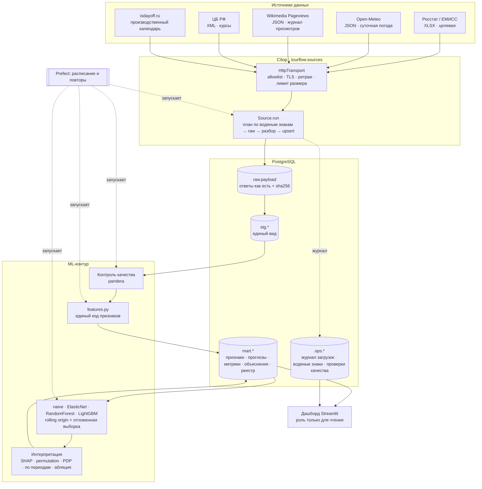

# Архитектура

## Схема

## Принципы построения

1. **Слои и односторонние зависимости.** `sources → stg → features → models/explain → mart → dashboard`.
   Нижние слои ничего не знают о верхних: дашборд только читает витрину, модели не ходят
   в источники, источники не знают о моделях.
2. **Разделение логики и инфраструктуры.** Шаги — обычные функции в `pipeline.py`; их вызывают
   и CLI, и Prefect. Источник получает транспорт извне (`HttpTransport` или `SyntheticTransport`),
   поэтому один и тот же код работает с живыми API и офлайн.
3. **Каждый источник описывает только своё** — что запросить (`plan`) и как разобрать (`parse`).
   Инкрементальность, идемпотентность и журнал реализованы один раз в `Source.run`.
4. **Единый код признаков** для обучения, бэктеста и прогноза — расхождение train/serve невозможно.
5. **Конфигурация вне кода:** доменные параметры — `config.yaml`, секреты и окружение — `.env`.
6. **Воспроизводимость:** фиксированный seed, хеш версии данных, детерминированная версия модели
   (хеш данных + параметров + признаков), реестр моделей с контрольной суммой артефакта.

## Слои хранения

| Схема | Что лежит | Кто пишет | Кто читает |
|---|---|---|---|
| raw | ответы источников без изменений, sha256 | ETL | ETL |
| stg | очищенные данные в едином виде | ETL | ETL |
| mart | признаки, прогнозы, метрики, объяснения, реестр моделей | ETL | ETL, дашборд |
| ops | журнал запусков и загрузок, водяные знаки, проверки качества | ETL | ETL, дашборд |

## Безопасность (базовый уровень)

| Угроза | Мера |
|---|---|
| Утечка секретов | Пароли только в `.env` (в `.gitignore`), `SecretStr` в настройках, DSN в логах без пароля; CLI отказывается работать с паролями по умолчанию |
| Избыточные права в БД | Три роли: владелец (только миграции), `tourflow_etl` (данные, без DDL), `tourflow_reader` (SELECT в mart/ops) для дашборда |
| SQL-инъекции | Только параметризованные запросы SQLAlchemy; имена таблиц проверяются по белому списку схем |
| SSRF / подмена источника | Только https и только хосты из `allowed_hosts`, проверка и для редиректов |
| Вредоносные файлы | Лимит размера ответа, XML через defusedxml (XXE, «XML-бомбы»), openpyxl в read-only |
| Подмена модели (pickle) | Артефакт загружается только после сверки sha256 с реестром |
| Доступ к дашборду | Пароль (scrypt с солью, сравнение за постоянное время), замедление перебора, XSRF-защита Streamlit |
| Сетевая поверхность | БД в изолированной сети без интернета и без портов наружу; дашборд и Prefect UI только на 127.0.0.1 |
| Повышение привилегий в контейнере | Пользователь без root, `cap_drop: ALL`, `no-new-privileges`, read-only ФС дашборда |
| Уязвимые зависимости | `ruff` (правила bandit), `bandit`, `pip-audit` в CI |
